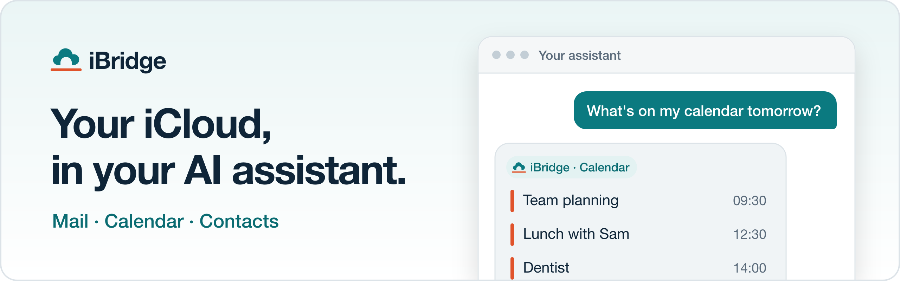

<picture>
  <source media="(prefers-color-scheme: dark)" srcset="https://raw.githubusercontent.com/AlexanderTar/ibridge-mcp/main/site/design/readme-cover/2-chat-dark@2x.png">
  <source media="(prefers-color-scheme: light)" srcset="https://raw.githubusercontent.com/AlexanderTar/ibridge-mcp/main/site/design/readme-cover/2-chat-light@2x.png">
  
</picture>

# iBridge

[](https://github.com/AlexanderTar/ibridge-mcp/actions/workflows/ci.yml)
[](LICENSE)
[](https://crates.io/crates/ibridge)
[](https://registry.modelcontextprotocol.io/?q=io.github.AlexanderTar%2Fibridge)
[](https://glama.ai/mcp/servers/AlexanderTar/ibridge-mcp)
[](https://glama.ai/mcp/connectors/io.github.AlexanderTar/ibridge)

An [MCP](https://modelcontextprotocol.io) server that lets Claude and other MCP clients read, search and manage your iCloud Mail, Calendar and Contacts.

It talks to iCloud over IMAP, SMTP, CalDAV and CardDAV with an app-specific password. Your Apple ID password is never used. Run it on your machine, run your own hosted copy, or use the hosted connector at [ibridge.fyi](https://ibridge.fyi).

iBridge is distributed as source. There are no prebuilt binaries: you build it with Rust, or you use the hosted connector.

## Tools

- **Mail:** list mailboxes, search, read messages and attachments, create drafts, send, unsubscribe, move and set flags.
- **Calendar:** list calendars, search and read events, create, update and delete them.
- **Contacts:** search and read contacts, create, update and delete them.
- **Account:** `account_status` reports which services are reachable.

Tools that change anything are marked as such. Mail, event and contact text reaches the client as plain JSON fields, with hidden characters and hidden HTML removed, and each read tool says where its text comes from.

## Start read-only

Some tools send mail, move messages, and change or delete events and contacts. While you find out what Claude does with them, run the server read-only: every tool that changes anything is hidden and rejected.

```sh
ibridge serve --stdio --read-only
```

Drop `--read-only` once you trust the setup.

## Install from source

You need Rust 1.98 or newer. First create an app-specific password at [account.apple.com](https://account.apple.com) under Sign-In and Security. Use one password per tool, so you can revoke it on its own.

```sh
cargo install ibridge
```

Or build from a checkout:

```sh
git clone https://github.com/AlexanderTar/ibridge-mcp
cd ibridge-mcp
cargo install --path crates/ibridge
```

Or install straight from git: `cargo install --git https://github.com/AlexanderTar/ibridge-mcp ibridge`.

## Connect Claude Code

Store the password in your system keychain, then register the server:

```sh
ibridge login
claude mcp add ibridge -- ibridge serve --stdio --read-only
```

`ibridge login` checks the password against iCloud before it stores it, and prints the `claude mcp add` line for your install. `ibridge doctor` checks the keychain, the network and the sign-in for each service.

To keep one server running in the background on macOS or Linux, `ibridge daemon install` starts it on loopback and prints the `claude mcp add --transport http` line, with its bearer token.

## Connect Claude Desktop

Build the Claude Desktop extension from your own build, in a checkout:

```sh
cargo build --release -p ibridge
cargo xtask mcpb
```

That writes `target/mcpb/ibridge-<version>-<platform>.mcpb` (it needs `zip` on your `PATH`). Open the file in Claude Desktop. It asks for your Apple ID and the app-specific password, keeps the password out of the config file and passes it to the server as an environment variable. The extension has no read-only switch; use Claude Code if you want one.

## Hosted connector

[ibridge.fyi](https://ibridge.fyi) runs iBridge for you, for Claude.ai and other remote MCP clients. Add a custom connector with the URL `https://mcp.ibridge.fyi/mcp`, sign in with Apple, then connect your iCloud address with an app-specific password. It costs US$1.99 per month or US$19.99 per year. Running iBridge on your own machine or self-hosting is free and never gated.

## Self-host

To run your own hosted server, build the image from a checkout:

```sh
docker build -t ibridge:src .
```

[docs/self-host.md](docs/self-host.md) covers running it, sign-in, backups and platforms such as Fly.io and Railway. Read [docs/security-model.md](docs/security-model.md) first: it says what the hosted server stores and where its protection ends.

## Reminders

The reminders tools read and change old-style reminder lists only. Apple's newer Reminders format is not visible over CalDAV, so iBridge cannot see those lists, and the list tool says so. Calendar events are not affected.

## Security

Credentials are only ever sent to Apple's iCloud hosts. See [SECURITY.md](SECURITY.md) to report a vulnerability.

## Contributing

Read [CONTRIBUTING.md](CONTRIBUTING.md) and the [Code of Conduct](CODE_OF_CONDUCT.md). [docs/local-development.md](docs/local-development.md) covers the toolchain, [docs/release.md](docs/release.md) covers releases and [CHANGELOG.md](CHANGELOG.md) lists what changed.

## Licence

Apache-2.0. See [LICENSE](LICENSE) and [NOTICE](NOTICE). The one exception is Apple's Sign in with Apple logo in `crates/ibridge-hosted/assets/`: it is Apple's artwork, committed unmodified, kept out of the published crate, and not covered by that licence.

mcp-name: io.github.AlexanderTar/ibridge
